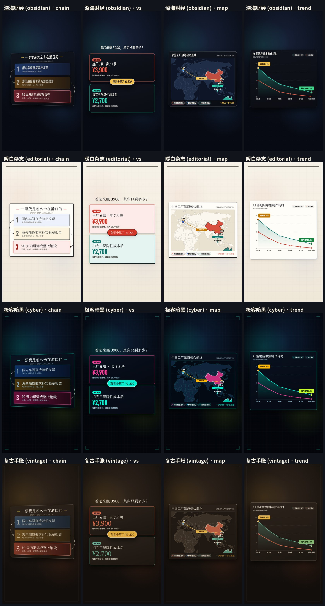
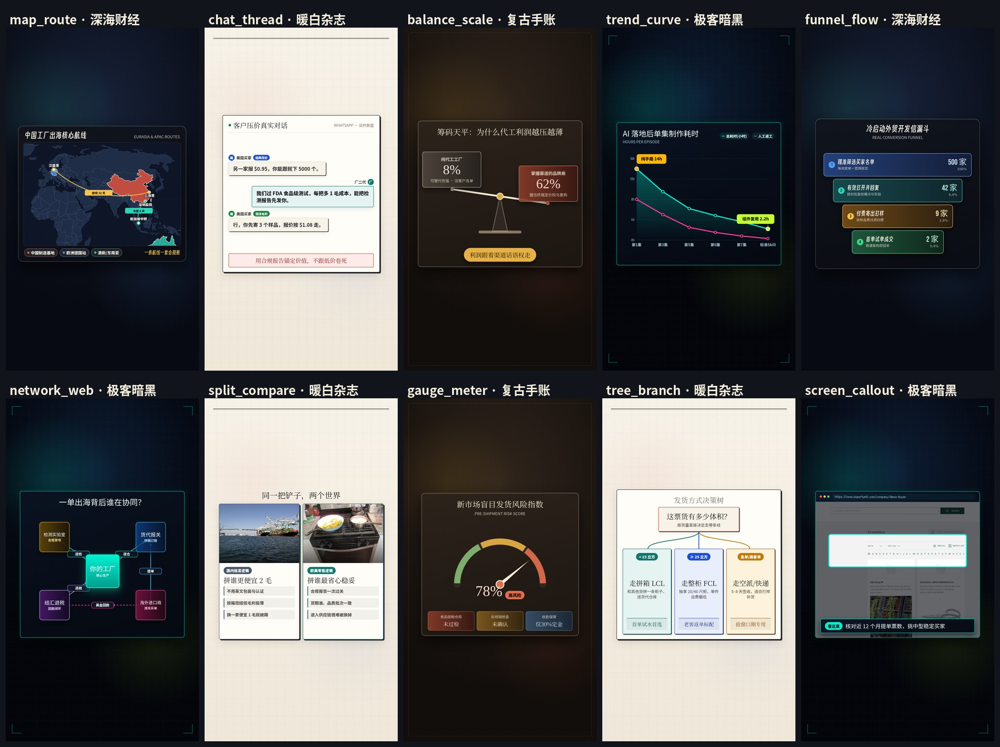

# Koubo Director

> **A universal, multi-skin AI Video Director Skill & 26-Component Remotion Engine for vertical (9:16) talking-head explainers.**  
> 通用、可定制皮肤的 AI 竖屏口播导演 Skill 与 26 套叙事组件引擎（适配小红书 / 抖音 / 视频号 / Reels / YouTube Shorts，兼容 **Antigravity / Claude Code / Codex**）。

---

## Why Koubo Director? / 为什么不是“又一套死板 PPT 模板”？

Most AI video workflows fall into two traps: either they dump dense, static slides that look like boring PowerPoint decks, or they hardcode one creator's visual style so every video looks identical.

**Koubo Director** solves both with a **4-layer decoupled architecture**:

```text
Layer 4 · channel.yaml      → Your brand, niche, intro/outro, safe-zone, music mood
Layer 3 · skin_tokens.tsx   → Visual identity: palette, surfaces, fonts, shadows, PiP, subtitles
Layer 2 · 26 Components     → Progressive within-screen storytelling primitives (Remotion + React)
Layer 1 · SKILL.md Grammar  → Director rules: within-screen accumulation, ≥0.5s settle, QA gates
```

---

## 1. One Engine, Four Radically Different Channel Skins / 一行切换 4 套皮肤

Change a single line (`skin: obsidian | editorial | cyber | vintage`) in `channel.yaml`, and the **exact same storyboard** transforms across 4 distinct visual worlds:

- **`obsidian`（深海财经）** — Deep obsidian glass + low-saturation jewel gradients + golden circular PiP
- **`editorial`（暖白杂志）** — Warm uncoated paper + crisp ink offset shadows + Songti serif headings (Vox / magazine feel)
- **`cyber`（极客暗黑）** — Pitch carbon micro-grid + electric cyan HUD brackets + DIN tech numerals
- **`vintage`（复古手账）** — Espresso walnut + aged parchment + terracotta / mustard / sage documentary warmth



---

## 2. 26 Within-Screen Storytelling Components / 26 套同屏递进叙事组件

Instead of wiping the whole screen every 3 seconds, every component builds progressively **inside one persistent canvas** ("动在屏内，少换整屏") so viewers always keep context.



| Category | Components (`k`) | Best For |
|---|---|---|
| **Causal & Frameworks** | `chain_card`, `dossier_grid`, `ledger_board`, `orb_ring`, `hero_pillars`, `chapter_deck` | Step-by-step logic, persistent summary boards, checklists, multi-chapter progression |
| **Numbers & Comparison** | `split_bars`, `waffle_card`, `vs_duel`, `trend_curve`, `funnel_flow`, `gauge_meter`, `balance_scale` | Profit breakdowns, market share (10×10 waffle), price duels, growth curves, conversion funnels, risk meters, trade-offs |
| **Geography & Systems** | `map_route`, `network_web`, `tree_branch`, `ruler_track` | Natural Earth world/regional shipping & flight arcs, supply-chain webs, decision trees, timelines |
| **Real Evidence & Stories** | `quote_zoom`, `screen_callout`, `question_frame`, `comic_grid`, `split_compare`, `photo_hero`, `chat_thread`, `phone_chart`, `top_tray` | 3D document zoom + red-circle highlight + translation, browser spotlight walkthroughs, real-photo frames, chat/email dialogues |

See [references/component-catalog.md](references/component-catalog.md) for the full decision matrix & props reference.

---

## 3. Battle-Tested Director Rules Built Into the Skill / 内置导演语法与硬门禁

- **Script Audit (5 Gates)**: Word budget, anti-lecture / anti-jargon rewrite, audience relatability, 3-tier fact-checking, visual coupling ([references/script-audit.md](references/script-audit.md)).
- **3 Rhythm Presets**: `deep-explainer`, `fast-take`, `documentary` ([references/director-grammar.md](references/director-grammar.md)).
- **≥0.5s Settle Rule**: Every animated card holds still for at least `0.5–0.6s` after its last reveal before cutting away.
- **Zero-Overlap Safe Band**: All cards stay inside `y = 460..1380` on `1080×1920`, keeping top-right PiP (`y = 205..455`) and bottom subtitles (`y ≈ 1440`) 100% clear.
- **Automated Hygiene Tools (`tools/`)**:
  - `prep_session.py`: Detects anamorphic landscape takes inside portrait sessions and restores 1:1 face proportions automatically.
  - `ep_metrics.py`: Measures `≥8s` canvas retention, `<4s` flash cuts, background flips/min, and asset replay rate.
  - `flashscan.py`: Enforces **0 isolated black frames**.
  - `render_chunks.sh`: Bundles Remotion once and reuses `SERVE_URL` across chunks (cuts render overhead dramatically).

---

## Quick Start / 3 分钟上手

### Step 1: Install the Skill into your AI Agent

Clone the repository and copy `skills/koubo-director/` into your Agent's skills directory:

```bash
git clone https://github.com/hanzili/koubo-director.git
cd koubo-director

# For Antigravity (workspace skill):
mkdir -p .agents/skills && cp -r skills/koubo-director .agents/skills/

# Or for Claude Code (global skill):
mkdir -p ~/.claude/skills && cp -r skills/koubo-director ~/.claude/skills/
```

### Step 2: Install Remotion Engine Dependencies & Fonts

```bash
cd engine && npm install && cd ..
# Optional: download open-source OFL fonts listed in engine/public/fonts/README.md
```

### Step 3: Create Your Channel Config & Scaffold an Episode

```bash
cp channel.example.yaml channel.yaml
# Edit channel.yaml: pick skin (obsidian | editorial | cyber | vintage) and rhythm_preset

python3 scripts/init_channel.py \
  --config channel.yaml \
  --episode ep01 \
  --title "My First Episode" \
  --out work/ep01
```

Then ask your AI Agent (Antigravity / Claude Code / Codex):
> *"Use the `koubo-director` skill to audit my script, design a storyboard with `editorial` skin, preview keyframe stills, and render the final video."*

---

## Extending with Your Own Custom Brand Skin

Add a 5th custom skin in ~30 lines inside [engine/src/skin_tokens.tsx](engine/src/skin_tokens.tsx) — all 26 components automatically inherit your colors, surfaces, borders, shadows, typography, PiP frame, and map palette without touching component code. See [references/themes-and-skins.md](references/themes-and-skins.md).

## License

MIT License — see [LICENSE](LICENSE). World map geometry uses public-domain Natural Earth 1:110m data.
